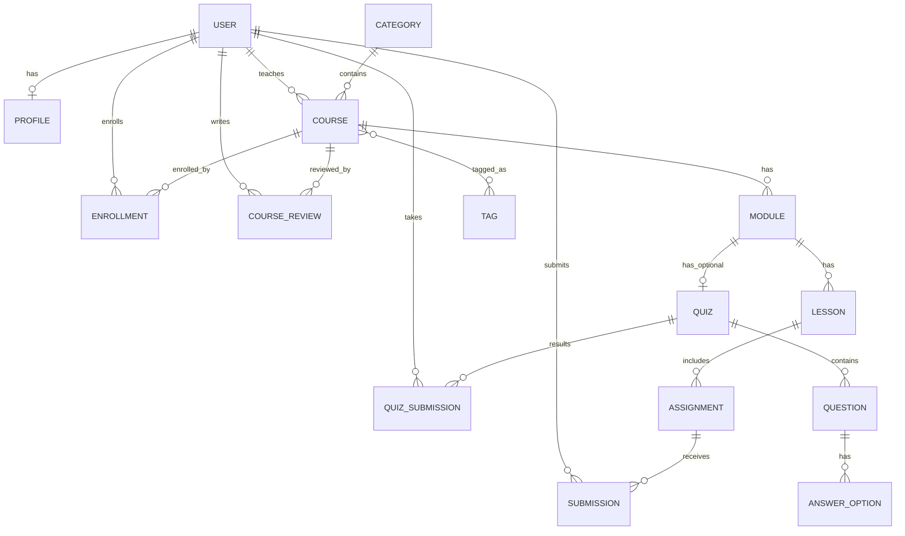

# LMS — Learning Management System

Учебная платформа для онлайн-курсов по ORM и Hibernate.
Серверное приложение на **Spring Boot 3 + JPA/Hibernate + PostgreSQL**, демонстрирующее
полную доменную модель LMS, REST API, работу с ленивой загрузкой и практики
тестирования JPA-приложений.

---

## Содержание

- [Возможности](#возможности)
- [Стек технологий](#стек-технологий)
- [Быстрый старт](#быстрый-старт)
- [Профили и конфигурация](#профили-и-конфигурация)
- [Демонстрационные данные](#демонстрационные-данные)
- [Доменная модель](#доменная-модель)
- [REST API](#rest-api)
- [Обработка ошибок](#обработка-ошибок)
- [Работа с ленивой загрузкой](#работа-с-ленивой-загрузкой)
- [Тестирование](#тестирование)
- [Архитектура проекта](#архитектура-проекта)
- [Docker](#docker)
- [CI](#ci)

---

## Возможности

### Преподаватель
- Создавать курсы с привязкой к категории и назначением преподавателя.
- Добавлять в курс модули (с порядковым номером) и уроки (с текстом и ссылкой на видео).
- Создавать к курсу теги (M–M) — для фильтрации и поиска.
- Создавать задания с дедлайном и максимальным баллом.
- Создавать тесты (один на модуль) с вопросами и вариантами ответов.
- Просматривать все решения студентов по своим заданиям.
- Выставлять оценки и оставлять комментарии.

### Студент
- Просматривать каталог курсов с фильтрацией по категории и преподавателю.
- Записываться на курс и отписываться от него.
- Видеть структуру курса: модули, уроки, тесты.
- Отправлять решения на задания (одна попытка на задание, проверка дедлайна).
- Проходить тесты (одна попытка на тест, подсчёт баллов по правильным ответам).
- Видеть свои результаты по заданиям и тестам.
- Оставлять отзывы с рейтингом и комментарием.

### Роли
В модели предусмотрено три роли — `STUDENT`, `TEACHER`, `ADMIN`. Для MVP реализованы
сценарии студента и преподавателя; администратор существует как роль для будущих
расширений (управление пользователями, категориями, модерация).

---

## Стек технологий

| Слой | Технологии |
|---|---|
| Язык | Java 17 |
| Фреймворк | Spring Boot 3.3.4 |
| Данные | Spring Data JPA, Hibernate 6.5 |
| БД | PostgreSQL 16 (dev/prod), H2 (test) |
| Валидация | Jakarta Bean Validation |
| Сборка | Maven |
| Тесты | JUnit 5, AssertJ, `@SpringBootTest` |
| Инфраструктура | Docker, docker-compose, GitHub Actions |

---

## Быстрый старт

### Требования

- JDK 17+
- Maven 3.9+
- Docker Desktop (или локально установленный PostgreSQL 14+)

### Запуск

```bash
# 1. Клонировать
git clone <repo-url>
cd lms

# 2. Поднять PostgreSQL
docker compose up -d postgres

# 3. Запустить приложение с профилем dev
mvn spring-boot:run -Dspring-boot.run.profiles=dev
```

Приложение стартует на **http://localhost:8080**.
При первом запуске создаётся схема БД и наполняются демонстрационные данные.

Проверка:

```bash
curl http://localhost:8080/api/courses
```

### Остановка и сброс

```bash
# Ctrl+C — остановить приложение
docker compose down       # остановить БД, данные сохраняются
docker compose down -v    # остановить БД и удалить volume (полный сброс)
```

---

## Профили и конфигурация

| Профиль | Файл | `ddl-auto` | Назначение |
|---|---|---|---|
| `default` | `application.yml` | `validate` | Prod-подобный: схема только проверяется |
| `dev` | `application-dev.yml` | `update` | Разработка: Hibernate создаёт/обновляет схему, работает сидинг |
| `test` | `src/test/resources/application-test.yml` | `create-drop` | Интеграционные тесты на H2 (PostgreSQL-совместимый режим) |

### О `ddl-auto` и миграциях

Профиль `default` использует `ddl-auto: validate` — Hibernate проверяет, что схема
соответствует `@Entity`, но **не создаёт и не меняет** таблицы. Это правильная
настройка для продакшена: приложение не должно молча менять схему.

В `docker-compose.yml` сервис `app` запускается с профилем `dev` (`ddl-auto: update`),
чтобы при первом запуске автоматически создалась схема и демо-данные. Это
**сознательный компромисс учебного проекта**: одна команда `docker compose up`
даёт рабочую систему.

В реальном продакшене схема должна управляться миграциями (**Flyway** или **Liquibase**):
SQL-миграции лежат в git, применяются по порядку, откатываются предсказуемо.
`ddl-auto` в таком случае ставят в `validate` или `none`. Профиль `default` в проекте
уже настроен под этот сценарий — если добавить Flyway, приложение будет работать
с `default` без изменений кода.

**Параметры БД** задаются через переменные окружения:

| Переменная | По умолчанию |
|---|---|
| `DB_URL` | `jdbc:postgresql://localhost:5432/lms` |
| `DB_USERNAME` | `lms` |
| `DB_PASSWORD` | `lms` |
| `SERVER_PORT` | `8080` |

Паролей в коде нет — всё через конфигурацию.

**Особенности JPA-конфигурации:**

- `spring.jpa.open-in-view: false` — сессия закрывается на границе `@Transactional`. Это осознанное решение: оно делает ленивую загрузку явной и заставляет правильно проектировать работу с сущностями.
- `hibernate.default_batch_fetch_size: 20` — уменьшает N+1 для ленивых коллекций.
- Все связи в модели объявлены с `fetch = FetchType.LAZY` явно.

---

## Демонстрационные данные

При запуске с профилем `dev` `DataInitializer` заполняет базу, если она пуста.
Это позволяет сразу увидеть работу всех сценариев без ручной подготовки.

Что создаётся:

- **2 категории**: Programming, Databases.
- **3 пользователя**: преподаватель Иван Петров, студенты Анна Иванова и Пётр Сидоров.
- **2 профиля** с биографией (1–1 с пользователем).
- **1 курс** «Основы Hibernate» (преподаватель, категория, длительность, дата старта).
- **2 модуля** («Введение в ORM», «Связи в JPA») с порядковыми номерами.
- **3 урока** с текстовым контентом и ссылкой на видео.
- **2 задания** с разными дедлайнами и максимальными баллами.
- **1 тест** на первый модуль с тремя вопросами: single choice × 2, multiple choice × 1.
- **3 тега** у курса: Java, Hibernate, Beginner (M–M).
- **2 записи** на курс (Enrollment, M–M через сущность).
- **1 сдача задания** с выставленной оценкой 92/100.
- **1 прохождение теста** с результатом 3/3.
- **1 отзыв** с рейтингом 5.

Инициализатор идемпотентен: если пользователи уже есть — пропускает.

---

## Доменная модель

15 сущностей, сгруппированных по назначению.

### Пользователи

- **`User`** — участник системы. Поля: имя, email (уникальный), роль (`STUDENT`, `TEACHER`, `ADMIN`).
- **`Profile`** — расширенная информация о пользователе (биография, ссылка на аватар). Связь **1–1** с `User`.

### Учебный контент

- **`Category`** — категория курса (например, «Программирование»). Связь **1–M** с `Course`.
- **`Course`** — сам курс. Связан с категорией и преподавателем (`ManyToOne`), содержит коллекцию модулей.
- **`Module`** — тематический раздел курса с порядковым номером. Связан с `Course`, содержит уроки. С модулем опционально связан **1–1** один тест.
- **`Lesson`** — урок с текстом и ссылкой на видео. Содержит коллекцию заданий.
- **`Assignment`** — домашнее задание с дедлайном и максимальным баллом.
- **`Quiz`**, **`Question`**, **`AnswerOption`** — иерархия теста: тест содержит вопросы, вопрос — варианты ответа. Связь теста с модулем — **1–1** (у модуля максимум один тест).

### Обучение и прогресс

- **`Enrollment`** — запись студента на курс. Реализована **отдельной сущностью** (а не прямым ManyToMany), потому что хранит дополнительные поля: дату записи и статус (`ACTIVE`, `COMPLETED`, `CANCELLED`). Уникальность на уровне БД: `(user_id, course_id)`.
- **`Submission`** — решение студента по заданию. Хранит текст, время отправки, оценку (nullable до проверки), комментарий преподавателя. Одна сдача на задание (UNIQUE `(assignment_id, student_id)`).
- **`QuizSubmission`** — результат прохождения теста. Одна попытка на тест (UNIQUE `(quiz_id, student_id)`).

### Отзывы и метки

- **`CourseReview`** — отзыв студента о курсе с рейтингом 1–5. Один отзыв на курс от одного студента (UNIQUE `(course_id, student_id)`).
- **`Tag`** — метка курса. Связь **M–M** с `Course` через join-table `course_tag`.

### Типы связей

- **1–1**: `User ↔ Profile`, `Module ↔ Quiz` (опциональная).
- **1–M**: `Category → Course`, `Course → Module`, `Module → Lesson`, `Lesson → Assignment`, `Quiz → Question`, `Question → AnswerOption`, `User → Course` (как преподаватель).
- **M–M**: `Course ↔ Tag` (через `@ManyToMany` + `@JoinTable`), `User ↔ Course` (через `Enrollment`), `User ↔ Assignment` (через `Submission`).

### Каскады и уникальность

- **Каскадное удаление** только для композиции: `Course → Module → Lesson → Assignment`, `Quiz → Question → AnswerOption`, `User → Profile`.
- **Без каскада** — для «исторических» данных (сдачи, отзывы, записи): удаление пользователя или курса должно обрабатываться в сервисе, а не молча тереть чужие данные.
- **UNIQUE-ограничения** на уровне БД: email, enrollment `(student, course)`, submission `(assignment, student)`, quiz_submission `(quiz, student)`, course_review `(course, student)`, quiz `module_id`.

Схема в формате Mermaid:



---

## REST API

Базовый URL: `http://localhost:8080`. Все ответы — JSON. Ошибки — в формате `ApiError` (см. ниже).

### Полный список эндпойнтов

**Пользователи и профили**

| Метод | Endpoint | Описание | Успех |
|---|---|---|---|
| `GET` | `/api/users` | Список пользователей (опционально `?role=STUDENT`) | `200` |
| `GET` | `/api/users/{id}` | Пользователь по id (с профилем) | `200` |
| `POST` | `/api/users` | Создать пользователя | `201` + `Location` |
| `PUT` | `/api/users/{id}/profile` | Создать/обновить профиль | `200` |

**Категории**

| Метод | Endpoint | Описание | Успех |
|---|---|---|---|
| `GET` | `/api/categories` | Список категорий | `200` |
| `GET` | `/api/categories/{id}` | Категория по id | `200` |
| `POST` | `/api/categories` | Создать категорию (name уникально) | `201` + `Location` |
| `DELETE` | `/api/categories/{id}` | Удалить категорию | `204` |

**Курсы**

| Метод | Endpoint | Описание | Успех |
|---|---|---|---|
| `GET` | `/api/courses` | Список курсов (фильтры `?categoryId=`, `?teacherId=`) | `200` |
| `GET` | `/api/courses/{id}` | Детали курса: модули, уроки, теги, средний рейтинг, число студентов | `200` |
| `POST` | `/api/courses` | Создать курс (title, categoryId, teacherId, duration, startDate) | `201` + `Location` |
| `PUT` | `/api/courses/{id}` | Обновить курс | `200` |
| `DELETE` | `/api/courses/{id}` | Удалить курс (каскад на модули/уроки/задания) | `204` |
| `POST` | `/api/courses/{id}/modules` | Добавить модуль в курс | `201` + `Location` |
| `POST` | `/api/courses/{id}/tags?name=` | Добавить тег к курсу | `204` |
| `DELETE` | `/api/courses/{id}/tags/{name}` | Убрать тег с курса | `204` |

**Запись на курс**

| Метод | Endpoint | Описание | Успех |
|---|---|---|---|
| `POST` | `/api/courses/{courseId}/enrollments` | Записать студента (body: `{"studentId":N}`) | `201` |
| `GET` | `/api/courses/{courseId}/enrollments` | Список записей на курс | `200` |
| `DELETE` | `/api/courses/{courseId}/enrollments/{studentId}` | Отписать студента | `204` |

**Задания и решения**

| Метод | Endpoint | Описание | Успех |
|---|---|---|---|
| `GET` | `/api/assignments/{id}` | Задание по id | `200` |
| `POST` | `/api/assignments/lessons/{lessonId}` | Создать задание в уроке | `201` + `Location` |
| `POST` | `/api/assignments/{id}/submit?studentId=` | Сдать решение | `201` + `Location` |
| `GET` | `/api/assignments/{id}/submissions` | Все сдачи по заданию | `200` |
| `PUT` | `/api/assignments/submissions/{submissionId}/grade` | Выставить оценку и комментарий | `200` |

**Тесты**

| Метод | Endpoint | Описание | Успех |
|---|---|---|---|
| `GET` | `/api/quizzes/{id}` | Тест по id | `200` |
| `POST` | `/api/quizzes/modules/{moduleId}` | Создать тест на модуль (1–1) | `201` + `Location` |
| `GET` | `/api/quizzes/{id}/questions` | Вопросы с вариантами **без** `correct` | `200` |
| `POST` | `/api/quizzes/{id}/questions` | Добавить вопрос с вариантами | `201` |
| `POST` | `/api/quizzes/{id}/take?studentId=` | Пройти тест (одна попытка) | `200` |
| `GET` | `/api/quizzes/{id}/submissions` | Результаты теста | `200` |

**Отзывы**

| Метод | Endpoint | Описание | Успех |
|---|---|---|---|
| `GET` | `/api/courses/{courseId}/reviews` | Отзывы о курсе | `200` |
| `POST` | `/api/courses/{courseId}/reviews?studentId=` | Оставить отзыв (rating 1–5) | `201` + `Location` |


---

### Примеры запросов
### Пользователи и профили

**Список пользователей (с фильтром по роли):**
```bash
curl "http://localhost:8080/api/users?role=STUDENT"
```

**Создание пользователя:**
```bash
curl -X POST http://localhost:8080/api/users \
  -H "Content-Type: application/json" \
  -d '{"name":"Maria","email":"m@example.com","role":"STUDENT"}'
```

Ответ `201 Created`, `Location: /api/users/{id}`.

**Создать или обновить профиль:**
```bash
curl -X PUT http://localhost:8080/api/users/1/profile \
  -H "Content-Type: application/json" \
  -d '{"bio":"Hibernate instructor","avatarUrl":"https://example.com/avatar.png"}'
```

### Категории

| Метод | Endpoint | Назначение |
|---|---|---|
| `GET` | `/api/categories` | Список категорий |
| `GET` | `/api/categories/{id}` | Одна категория |
| `POST` | `/api/categories` | Создать (name — уникальное) |
| `DELETE` | `/api/categories/{id}` | Удалить |

### Курсы

**Список с фильтрами:**
```bash
curl "http://localhost:8080/api/courses?categoryId=1&teacherId=1"
```

**Детали курса (с модулями, уроками, тегами, средним рейтингом и количеством студентов):**
```bash
curl http://localhost:8080/api/courses/1
```

**Создание:**
```bash
curl -X POST http://localhost:8080/api/courses \
  -H "Content-Type: application/json" \
  -d '{"title":"Spring Boot","categoryId":1,"teacherId":1,"duration":"6 weeks"}'
```

**Добавление модуля:**
```bash
curl -X POST http://localhost:8080/api/courses/1/modules \
  -H "Content-Type: application/json" \
  -d '{"title":"REST controllers","orderIndex":1,"description":"..."}'
```

**Управление тегами:**
```bash
curl -X POST "http://localhost:8080/api/courses/1/tags?name=Spring"
curl -X DELETE http://localhost:8080/api/courses/1/tags/Spring
```

### Запись на курс

```bash
# Записаться
curl -X POST http://localhost:8080/api/courses/1/enrollments \
  -H "Content-Type: application/json" \
  -d '{"studentId":2}'

# Список записанных студентов
curl http://localhost:8080/api/courses/1/enrollments

# Отписаться
curl -X DELETE http://localhost:8080/api/courses/1/enrollments/2
```

Повторная запись → `409 Conflict`. Попытка записать преподавателя → `400 Bad Request`.

### Задания и решения

```bash
# Создать задание в уроке
curl -X POST http://localhost:8080/api/assignments/lessons/1 \
  -H "Content-Type: application/json" \
  -d '{"title":"HW1","description":"...","dueDate":"2026-12-31","maxScore":100}'

# Сдать решение
curl -X POST "http://localhost:8080/api/assignments/1/submit?studentId=2" \
  -H "Content-Type: application/json" \
  -d '{"content":"My answer"}'

# Все сдачи по заданию
curl http://localhost:8080/api/assignments/1/submissions

# Выставить оценку
curl -X PUT http://localhost:8080/api/assignments/submissions/1/grade \
  -H "Content-Type: application/json" \
  -d '{"score":95,"feedback":"Good job"}'
```

Ограничения:
- повторная сдача → `409 Conflict`;
- сдача после дедлайна → `400 Bad Request`;
- оценка вне диапазона `[0, maxScore]` → `400 Bad Request`.

### Тесты

```bash
# Создать тест на модуль (один тест на модуль)
curl -X POST http://localhost:8080/api/quizzes/modules/1 \
  -H "Content-Type: application/json" \
  -d '{"title":"ORM basics","timeLimit":15}'

# Добавить вопрос с вариантами
curl -X POST http://localhost:8080/api/quizzes/1/questions \
  -H "Content-Type: application/json" \
  -d '{
    "text":"What is ORM?",
    "type":"SINGLE_CHOICE",
    "options":[
      {"text":"Object-Relational Mapping","correct":true},
      {"text":"Object Random Method","correct":false}
    ]
  }'

# Вопросы для прохождения (без флага correct)
curl http://localhost:8080/api/quizzes/1/questions

# Пройти тест
curl -X POST "http://localhost:8080/api/quizzes/1/take?studentId=2" \
  -H "Content-Type: application/json" \
  -d '{"answers":[{"questionId":1,"selectedOptionIds":[1]},{"questionId":2,"selectedOptionIds":[4,5]}]}'

# Результаты теста
curl http://localhost:8080/api/quizzes/1/submissions
```

**Подсчёт баллов:** для `SINGLE_CHOICE` правильным считается выбор единственного правильного
варианта; для `MULTIPLE_CHOICE` — точное совпадение множеств выбранных и правильных ответов.
Частичный выбор на multiple choice не засчитывается.

**Важно:** эндпойнт `GET /questions` возвращает варианты без поля `correct` — чтобы студент
не увидел правильные ответы через DevTools.

### Отзывы

```bash
curl -X POST "http://localhost:8080/api/courses/1/reviews?studentId=2" \
  -H "Content-Type: application/json" \
  -d '{"rating":5,"comment":"Excellent course"}'

curl http://localhost:8080/api/courses/1/reviews
```

Повторный отзыв от того же студента → `409 Conflict`.

---

## Обработка ошибок

Все исключения проходят через `GlobalExceptionHandler` (`@RestControllerAdvice`)
и возвращаются в едином формате:

```json
{
  "timestamp": "2026-11-12T14:43:03Z",
  "status": 404,
  "error": "Not Found",
  "message": "Course with id=999 not found",
  "path": "/api/courses/999"
}
```

Для ошибок валидации добавляется `fieldErrors`:

```json
{
  "status": 400,
  "error": "Validation Failed",
  "message": "Одна или несколько проверок не прошли",
  "fieldErrors": {
    "name": "must not be blank",
    "email": "must be a well-formed email address"
  }
}
```

| Исключение | HTTP-статус |
|---|---|
| `ResourceNotFoundException` | `404` |
| `DuplicateResourceException` | `409` |
| `BusinessRuleException` | `400` |
| `MethodArgumentNotValidException` | `400` + `fieldErrors` |
| Непредвиденные | `500` |

---

## Работа с ленивой загрузкой

Ленивая загрузка — одна из центральных тем проекта. Ключевые решения:

### Все связи ленивые по умолчанию

`@OneToMany`, `@ManyToMany`, `@ManyToOne`, `@OneToOne` — везде явно указан
`fetch = FetchType.LAZY`. Это соответствует лучшим практикам JPA: EAGER по умолчанию
для `ManyToOne` и `OneToOne` часто приводит к неожиданной загрузке всего графа.

### `open-in-view: false`

Сессия закрывается на границе `@Transactional`-метода. Это заставляет явно решать,
где именно загружать связанные данные, и предотвращает неявную подгрузку в шаблонах
или контроллерах.

### Тест на `LazyInitializationException`

`LazyLoadingIntegrationTest` демонстрирует оба сценария:

- **Проблема:** курс загружается через `courseRepository.findById(id)` вне транзакции;
  при попытке `course.getModules().size()` выбрасывается `LazyInitializationException`.
- **Обход:** тот же курс загружается через `findWithModulesById(id)` — `@EntityGraph`
  подтягивает модули сразу, и обращение к коллекции безопасно.

### Обход проблемы в продакшене

Три паттерна, применённые в проекте:

1. **`@EntityGraph` в репозиториях.** Точечно указывает, какие связи подгружать
   одним запросом: `CourseRepository.findWithModulesById`,
   `EnrollmentRepository.findWithCourseByStudentId`,
   `SubmissionRepository.findWithDetailsById`,
   `QuizSubmissionRepository.findByQuizId`,
   `CourseReviewRepository.findByCourseId`.

2. **DTO внутри `@Transactional`-методов сервиса.** Методы `getCourseDetail`,
   `listCourseSummaries`, `getUserResponse` собирают DTO, пока сессия ещё открыта.
   Контроллер получает уже готовый объект — никакой магии, никаких сюрпризов.

3. **`@BatchSize` на коллекциях.** `Module.lessons` загружается пачками по 20 —
   это уменьшает N+1 на больших выборках.

### `MultipleBagFetchException`

Попытка джойнить в `@EntityGraph` сразу две `List<>`-коллекции (например,
`modules` и `modules.lessons`) приводит к `MultipleBagFetchException` — Hibernate
не может себе позволить два декартовых произведения. Решение: `modules` тянется
через `@EntityGraph`, а `lessons` — лениво внутри транзакции (с `@BatchSize`).

---

## Тестирование

### Интеграционные тесты (25)

```bash
mvn test
```

`@SpringBootTest` на **H2** в режиме `MODE=PostgreSQL` (совместимый SQL-диалект).
Профиль `test`, `ddl-auto: create-drop`. Каждый тест помечен `@Transactional`
и откатывается после выполнения.

| Класс | Что проверяет |
|---|---|
| `CourseServiceIntegrationTest` | CRUD курса, иерархия модуль→урок→задание, каскадное удаление, теги M–M, `ResourceNotFoundException` |
| `EnrollmentServiceIntegrationTest` | Запись/отписка, дубль, запрет для TEACHER, `@EntityGraph`-загрузка студентов |
| `AssignmentServiceIntegrationTest` | Сдача, дедлайн, дубль, оценка в диапазоне, несуществующая сдача |
| `QuizServiceIntegrationTest` | Подсчёт для single/multiple choice, одна попытка, один тест на модуль, валидация вопросов |
| `LazyLoadingIntegrationTest` | `LazyInitializationException` вне сессии + работа `@EntityGraph` |

### Smoke-test REST API (опционально, Windows)

Для быстрой end-to-end проверки на живом PostgreSQL есть PowerShell-скрипт
`test-api.ps1` (Windows). Запуск — после того, как приложение поднято с профилем `dev`:

```powershell
.\test-api.ps1
```

Скрипт выполняет 29 проверок: чтение, 404/400/409, создание пользователя, запись
на курс, прохождение теста (с проверкой, что `correct` не утекает в student-API),
сдачу задания, выставление оценки, отзыв, отписку. Возвращает `PASSED / FAILED`
и `exit 1` при любом падении.

Если PowerShell недоступен — все ключевые сценарии продублированы `curl`-командами
в разделе [REST API](#rest-api).

---

## Архитектура проекта

```
com.example.lms
├── LmsApplication              — entry point
├── entity/                     — 15 JPA-сущностей + BaseEntity
├── enums/                      — Role, EnrollmentStatus, QuestionType
├── repository/                 — Spring Data JPA (15 интерфейсов)
├── service/                    — Бизнес-логика, @Transactional
├── web/                        — 5 @RestController
│   └── dto/                    — record'ы запросов и ответов + валидация
├── exception/                  — 3 исключения + GlobalExceptionHandler
└── config/                     — DataInitializer (dev)
```

**Слои:** `web → service → repository → entity`. Зависимости идут строго вниз.

**Принципы:**

- Конструкторная инъекция (`@RequiredArgsConstructor`).
- `@Transactional` на уровне сервиса, `readOnly = true` для методов чтения.
- DTO формируются в сервисе (внутри транзакции) — это ключевой паттерн для
  безопасной работы с ленивыми связями.
- Логирование ключевых операций (`@Slf4j`).
- `equals/hashCode` у сущностей — по `id`, `toString` — без коллекций
  (чтобы случайно не дёрнуть lazy вне транзакции).
- Валидация входных данных — через Jakarta Bean Validation на DTO,
  а не в контроллере.

---

## Docker

Multi-stage сборка:

- **Stage 1** (`maven:3.9-eclipse-temurin-17`) — собирает `jar`.
- **Stage 2** (`eclipse-temurin:17-jre-alpine`) — запускает приложение от непривилегированного пользователя.

Итоговый образ ~180 MB.

### Запуск через docker-compose

```bash
docker compose up -d --build
docker compose logs -f app
```

`docker-compose.yml` описывает два сервиса: `postgres` (с healthcheck) и `app`
(с зависимостью от healthcheck). Приложение автоматически получит `DB_URL`,
`DB_USERNAME`, `DB_PASSWORD` и профиль `dev` — те же данные, что при локальном запуске.

### Только образ (без compose)

```bash
docker build -t lms:latest .
docker run --rm -p 8080:8080 \
  -e DB_URL=jdbc:postgresql://host:5432/lms \
  -e DB_USERNAME=lms \
  -e DB_PASSWORD=lms \
  -e SPRING_PROFILES_ACTIVE=dev \
  lms:latest
```

---

## CI

`.github/workflows/ci.yml` запускается на каждый `push` и `pull_request` в `main`:

1. Установка JDK 17 с кешем Maven.
2. `mvn -B -q test` — прогон всех 25 интеграционных тестов на H2.
3. `mvn -B -q -DskipTests package` — сборка `jar`.
4. `docker build` — проверка, что образ собирается.

При падении тестов `surefire`-отчёты выгружаются в артефакты workflow
для последующего разбора.

Docker и PostgreSQL в CI **не используются** — тесты на H2 выполняются за ~6 секунд,
что делает пайплайн быстрым и воспроизводимым.